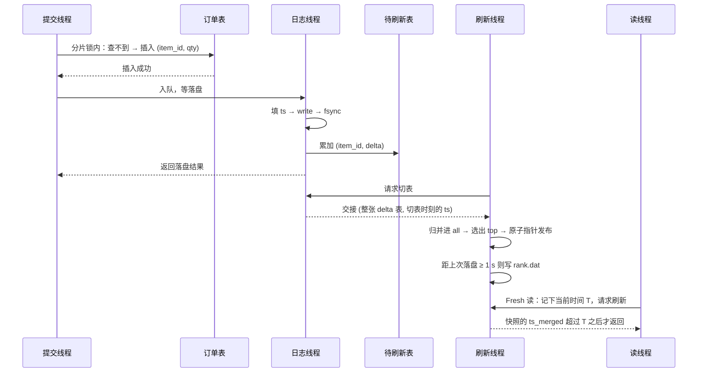
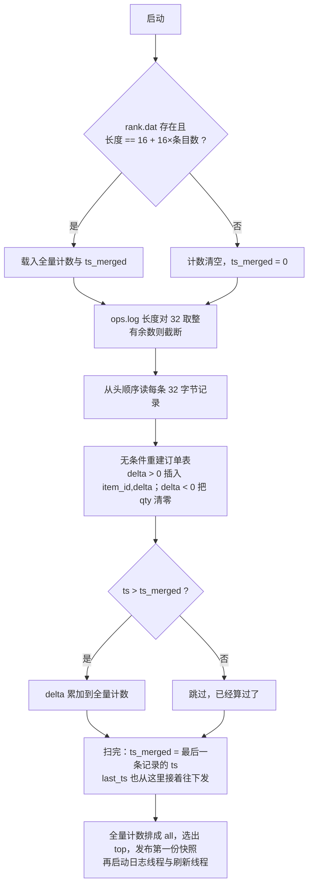

# 实时排行榜 详细设计

> 阶段 1 产出。需求见 `docs/REQUIREMENTS.md`，FR / INV 编号沿用该文档。

---

## 1. 模块划分

| 模块 | 职责 | 对应需求 |
|---|---|---|
| `Engine` | 门面，组装其余部件，对外只暴露 `Purchase` / `Refund` / `TopK` / `Metrics` | FR-1、FR-2、FR-7 |
| `OrderStore` | 分片订单表，幂等判重 | FR-3、FR-4 |
| `OpLog` | 提交队列、`ts` 分配、`ops.log` 追加、合批 fsync、delta 投递 | FR-5、FR-14、FR-15 |
| `StagingBuffer` | 按 item 分片的 delta 表，整表交接给刷新线程 | FR-12 |
| `RankStore` | 排行榜快照、`rank.dat` 读写 | FR-7、FR-16 |
| `Flusher` | 刷新触发判定、刷新合并、应用 delta、发布快照 | FR-9~FR-13 |
| `Recovery` | 启动时读 `rank.dat`、扫 `ops.log`、重建两张表 | FR-17 |
| `Config` / `Metrics` | 参数注入、指标采集 | FR-13、FR-20 |

目录结构：

```
include/rank/   config.h  types.h  engine.h  metrics.h
src/            order_store  op_log  staging  rank_store  flusher  recovery  engine
tests/          GoogleTest 用例
bench/          并发压测入口（FR-18）
```

---

## 2. 线程模型

先把需求里的行为列全，看每种能不能同时跑多份，线程数就定下来了。

### 2.1 四种行为

| 行为 | 出自 | 能不能同时跑多份 |
|---|---|---|
| 购买 / 回退 | FR-1~FR-6 | **能**。不同订单互不相干；同一订单只能有一个做成，靠订单表的锁解决，不必让所有订单排队 |
| 读排行榜 | FR-7、FR-8 | **能**。纯读 |
| 记录操作（写 `ops.log` 并落盘） | FR-14、FR-15 | **不能**。要顺序追加、`ts` 递增；而且 fsync 耗时和写多少数据基本无关，几个线程各 fsync 一次，不如一个线程拼起来写一次 |
| 更新排行榜（合增量、重建榜单、写 `rank.dat`） | FR-9~FR-12、FR-16 | **不能**。FR-10 要求同一时刻最多一次 |

### 2.2 线程数

前两种能并行，又都由外部调用方主动发起 → 在调用方自己的线程上跑完，引擎不开线程。后两种各要一个专属线程；「更新排行榜」的触发里有「定时到点」，没有外部调用它也得自己醒过来干活。

这两个线程不能合成一个：更新排行榜一轮要把全量计数过一遍选前 K（1e5 个物品约 1 ms），还要隔段时间写 `rank.dat`。挤在一起的话这段时间没人写盘，提交延迟跟着榜单更新一起抖，违反 FR-11。

| 线程 | 几个 | 跑哪个行为 |
|---|---|---|
| 提交线程 | 1~64，调用方的 | 购买 / 回退 |
| 读线程 | 任意多，调用方的 | 读排行榜 |
| 日志线程 | 1，引擎创建 | 记录操作 |
| 刷新线程 | 1，引擎创建 | 更新排行榜 |

引擎线程在恢复流程跑完之后启动，析构时置停止标志并 `join`。

### 2.3 交接

```
购买/回退 ──①──> 记录操作 ──②──> 更新排行榜 ──③──> 读排行榜
```

| 交接 | 传什么 | 几个写、几个读 | 用什么接 |
|---|---|---|---|
| ① | 一笔待写的操作 | 多个提交线程放，日志线程一个取 | 互斥量加条件变量的队列，上限 64K 条 |
| ② | 一批 `(物品, 增量)` | 日志线程写，刷新线程读 | 整张待刷新表交过去，只有交接那一下加锁 |
| ③ | 一份排好序的榜单 | 刷新线程写，读线程多个读 | 原子指针，指向发布后不再改的快照 |

反向有两处等待：提交线程等①落盘才返回（FR-5），`Fresh` 读等③发布新快照才返回（FR-8）。都用条件变量。

②的时机由 FR-15 定死：增量必须等 fsync 返回之后才进待刷新表，而 fsync 在「记录操作」里，所以这步归日志线程顺手做。于是待刷新表只有一个人写，刷新线程只在整张表交过去之后才碰，表里存普通 `int64_t` 即可。

### 2.4 数据归属

| 数据 | 谁写 | 谁读 | 怎么保护 |
|---|---|---|---|
| 订单表 | 提交线程，多个 | 提交线程 | 按 `order_id` 分 64 片，每片一把互斥量 |
| 提交队列 | 提交线程放，日志线程取 | 同左 | 一把互斥量加条件变量 |
| `ops.log` | 日志线程 | 启动时恢复 | 写的人只有一个，不用锁 |
| 待刷新表 | 日志线程 | 刷新线程，交接之后 | 只在交接那一下加锁 |
| 快照 | 刷新线程 | 读线程，多个 | 原子指针，换指针就是发布 |
| `rank.dat` | 刷新线程 | 启动时恢复 | 写的人只有一个 |

真正的竞争点只有订单表的分片锁和提交队列的锁。读排行榜只看快照，整条读路径一把锁都没有。

订单表为什么不也交给单线程：幂等判断必须在写文件之前做完（需求 §3 第一条顺序规则），交给日志线程就等于让它在 fsync 之外再扛下全部哈希查找，立刻变成瓶颈。

待刷新表也按 `hash(item_id)` 分片，但写的人只有一个，分片只是让单张 map 小一点、刷新能一片一片处理。分片数按 FR-20 可配；以后若改成多线程投递增量，分片键必须是 `hash(item_id)`（需求 §3）。

---

## 3. 核心数据结构

四份数据，对应 §2.4 的归属表。

### 3.1 订单表

`order_id → (item_id, qty)`，哈希表，全量常驻，查改插均摊 `O(1)`。模拟数据库订单表的主键索引：订单号唯一，一笔订单最多产生购买的 `+qty` 和回退的 `-qty` 各一次，回退复用同一个订单号。

记录语义：

| 表里的情况 | 含义 |
|---|---|
| 查不到 | 订单号没用过 |
| `qty > 0` | 已购买，`+qty` 已发出 |
| `qty == 0` | 已回退，`+qty` 和 `-qty` 都已发出 |

`qty == 0` 之所以能当标记，是因为 FR-4 把 `qty ≤ 0` 挡在接口之外。

对这张表的全部动作：

| 场景 | 动作 |
|---|---|
| 购买 | 订单号不在表里才能插入，插入即占号 |
| 回退 | 取出 `item_id` 和 `qty` 生成 `-qty`，再把 `qty` 置 0，记录不删除 |
| 落盘失败回滚 | 购买删掉记录，回退把 `qty` 还原 |
| 启动恢复 | 按 `ops.log` 逐条重放 |
| INV-1 对账 | 表里所有 `qty` 按 `item_id` 求和 |

并发：

- 按 `hash(order_id) & 63` 分 64 片，每片一把 `std::mutex`，分片数可配（FR-20）。分片键只能是 `order_id`，同一笔订单的购买和回退要落在同一把锁上。
- 查、判断、写三步必须在同一把分片锁内连续完成，不可拆开——这是幂等的唯一保证点。
- 锁内只做表操作，等待落盘在放锁之后（§5）。

```cpp
struct OrderEntry {
    uint64_t item_id;
    int64_t  qty;            // > 0 已购买；== 0 已回退
};

struct alignas(64) OrderShard {   // 按 cache line 对齐。不对齐的话相邻两片的 mutex 会落在
    std::mutex m;                 // 同一条 cache line 上，两个线程锁的是不同的片也会互相拖慢
    std::unordered_map<uint64_t, OrderEntry> tab;
};

std::array<OrderShard, 64> shards;       // 启动时每片 reserve(预计订单数 / 64)，躲开 rehash
```

开销：1e6 订单 × 约 48 字节 ≈ 48 MB（记录 16 字节，其余是节点指针和桶数组），常驻不淘汰。

### 3.2 操作记录与提交队列

一次购买或回退就是一条操作记录 `(ts, order_id, item_id, delta)`，`delta` 为 `+qty` 或 `-qty`。这是写进 `ops.log` 的全部内容，也是恢复时唯一的依据。

| 字段 | 谁填 | 说明 |
|---|---|---|
| `ts` | 日志线程 | 严格递增，规则见 FR-14 |
| `order_id` | 提交线程 | 来自接口参数 |
| `item_id` | 提交线程 | 回退的从订单表取 |
| `delta` | 提交线程 | 购买 `+qty`，回退 `-qty` |

- 符号即操作类型（`delta > 0` 购买，`delta < 0` 回退），不另存一个字段。
- 回退记录自带 `item_id` 和 `delta`，恢复时逐条累加即可，不用先找到对应的购买记录。

提交线程把记录放进队列，日志线程一个个取出来写盘，再把落盘结果带回来。去程和回程是同一个对象：

```cpp
struct OpRecord {                     // 写进 ops.log 的 32 字节，小端直存，无文件头
    uint64_t ts;
    uint64_t order_id;
    uint64_t item_id;
    int64_t  delta;
};

struct PendingOp {
    OpRecord rec;
    Result   res;                     // 落盘结果，日志线程填
    std::binary_semaphore done{0};    // 日志线程 release，提交线程 acquire
};

std::deque<PendingOp*> q;             // 配一把 std::mutex 和两个 condition_variable
```

- 先进先出，上限 64K 条，满了提交线程等（FR-15）。
- `PendingOp` 建在提交线程栈上，队列里只放指针——提交线程要等到落盘才返回，对象活得够久。
- 两个条件变量管队列的「非空」和「不满」；提交线程等自己那笔落盘用的是 `PendingOp` 上的信号量，不占队列锁。日志线程等「非空」要带 1 ms 超时，否则没有写入时它一直停在这儿，刷新线程也就取不走待刷新表（用例 C-09）。
- 日志线程一轮：取一批（4096 条或 2 ms）→ 顺序填 `ts` → write → fsync → 把 `(item_id, delta)` 投进待刷新表 → 逐个 `release`。投递必须排在 `release` 前面（INV-5）。

### 3.3 待刷新表

`item_id → delta`，哈希表。日志线程每写完一条操作记录，就把它的 `delta` 按 `item_id` 累加进去，同一个物品的多次操作合成一个数——加法可交换，不需要保序。刷新线程整张取走，取走之后这张表重新从空的开始攒。

`ts_merged` 是上一次更新进排行榜的时间戳，取日志线程切表那一刻的当前时间。取走的那张表全量应用，不留尾巴。`ops.log` 里 `ts > ts_merged` 的记录就是还没算进排行榜的，重启时只补算这部分（§7）；`Fresh` 读也靠它判断自己等够了没有（§6）。

```cpp
std::unordered_map<uint64_t, int64_t> staging;        // item_id -> delta，只有日志线程写

struct Handoff {                                      // 刷新线程取走的东西
    std::unordered_map<uint64_t, int64_t> deltas;
    uint64_t ts;                                      // 切表那一刻的时间戳，应用完写进 ts_merged
};
```

- 整张表换走，不是遍历清零：刷新线程应用取走的那张时，日志线程照常往新的那张里写，两边不碰同一张表，所以表里存普通 `int64_t`，不用锁也不用原子类型。
- 按 `hash(item_id)` 分 8 片（FR-20 可配），只是让单张 map 小一点、刷新能一片一片应用，和锁无关。
- 内存占用是 `O(两次刷新之间被碰过的物品数)`，和提交了多少操作无关。

### 3.4 快照

排行榜数据就是这一份快照：全量 `(item_id, count)` 加一个时间戳，建好之后不再改。读请求直接取它。

| 什么时候建 | 做什么 |
|---|---|
| 启动恢复完 | 按 `rank.dat` 载入的计数加上补算的部分建一份发布，读请求不用等第一次刷新 |
| 每次刷新 | 把取走的 delta 归并进上一份快照，排出新的前 K 名，整份换掉 |

```cpp
struct Snapshot {                                        // 建好就不再改
    uint64_t version;                                    // 每次刷新 +1
    uint64_t ts_merged;                                  // 更新到哪个时间点，随查询结果一起返回
    std::vector<std::pair<uint64_t, int64_t>> all;       // 全量计数，按 item_id 升序
    std::vector<std::pair<uint64_t, int64_t>> top;       // 前 K 名，count 降序、item_id 升序
};
std::atomic<std::shared_ptr<const Snapshot>> published;
```

- 读：`load` 一次指针，从 `top` 拷前 k 条返回，没有锁也没有原子加。读到一半快照被换掉也不影响，手里那份不会变（INV-8）；老的等引用计数归零才释放。
- `all` 按 `item_id` 升序排着，刷新时把取走的 delta 也按 `item_id` 排一遍，两边归并一次就得到新的 `all`，不用再留一张可改的计数表。`count == 0` 的物品留在 `all` 里（下次还可能被买到），但不进 `top`。
- 快照只在刷新时整份换掉，所以它是上一次切表那一刻的榜单，不是实时值——待刷新表里攒着的增量还没算进去。`ts_merged` 就是告诉调用方这份数据更新到什么时候，`Fresh` 读等的也是它（§6）。
- `rank.dat` 直接写 `all`（FR-16 要的就是全量计数），不用另外的数据源。

开销：归并 `O(M + D)`，选前 K 用 `nth_element` 再排这 K 条 `O(M) + O(K log K)`，M = 1e5 时合计约 1 ms；每次刷新重新分配一份 `all`（1e5 条约 1.6 MB），旧的等读完才释放。

---

## 4. 事件流时序



三处先后不能换，换了就是正确性问题，代码里要写注释说清楚：

| 顺序 | 换了会怎样 |
|---|---|
| 先改订单表，成功了才写文件 | 并发的重复提交会同时写两条记录，幂等失效 |
| fsync 返回之后才累加进待刷新表 | 排行榜算了但文件里没有，重启后榜单永久多于订单表 |
| 累加进待刷新表之后才返回调用方 | 调用方拿到成功、紧接着 `Fresh` 读却读不到这笔（INV-5） |

---

## 5. 幂等与去重

判重只看订单表里那条记录，不另外维护状态位（见 §3.1）：

| 表里的情况 | 收到 Purchase | 收到 Refund |
|---|---|---|
| 查不到 | 插入 `(item_id, qty)`，生成 `delta = +qty` 的记录 | `ORDER_NOT_FOUND` |
| `qty > 0` | `ALREADY_PURCHASED` | 取出 `item_id` 和 `qty`，把 `qty` 清零，生成 `delta = -qty` 的记录 |
| `qty == 0` | `ALREADY_PURCHASED` | `ALREADY_REFUNDED` |

提交一笔操作的完整步骤：

1. 参数校验，不合法直接 `INVALID_ARG`，不碰订单表。
2. 拿分片锁，按上表判断，该写的直接写进去，放锁。查、判、写三步必须在同一把锁里连着做完——**这是「一笔订单至多 +qty 一次、至多 -qty 一次」的唯一保证点**。写成功的那个线程继续往下走，其余线程在这里就带着 `ALREADY_*` 返回了。
3. 入队，等落盘，按结果返回。必须先放锁再等：fsync 是毫秒级，持锁等会把整个分片堵死。

落盘失败时再拿一次锁把订单表改回去——Purchase 删掉刚插的那条，Refund 把 `qty` 还原成取出来的那个值——这样订单表和 `ops.log` 始终对得上，INV-1 的对账才成立。此时引擎已经转为只读（FR-15），不会再有新的提交进来。

订单表先改、文件后写，中间崩了的话这笔操作在 `ops.log` 里不存在，重启后等于没发生过（查不到这个订单，或者它的 `qty` 还是原值）。恢复流程不需要为它做特判，客户端重试即可。

---

## 6. 合并与刷新

刷新线程循环，每轮先判是否该刷：

| 触发 | 判定 | 默认值 |
|---|---|---|
| 到点 | 距上次刷新 ≥ `T_max` | 200 ms |
| `Fresh` 读 | 有读者在等，且距上次刷新 ≥ `T_min` | 10 ms |
| 攒够了 | 当前表里的物品数 ≥ `N_pending_max` | 10000 |

一次刷新的步骤：

1. 置切表请求，等日志线程交接出 `(delta 表, 切表时刻的 ts)`。
2. 把 delta 全量归并进上一份快照的 `all`，选出新的 `top`，`ts_merged` 置成交接带来的那个 ts，`version + 1`，原子指针发布。
3. 距上次落盘 ≥ 1 s 就写一次 `rank.dat`：写 `rank.dat.tmp` → fsync → `rename` 覆盖，内容是刚发布那份快照的 `all` 和 `ts_merged`，不需要额外加锁。1e5 个物品约 1.6 MB。

两点：

- **多个 `Fresh` 读合成一次刷新（FR-10）**：读者共用同一个「请求刷新」标志和同一个条件变量，同一时刻只有一次刷新在跑，期间到达的读者都挂在这个条件变量上等这一次的结果。
- **`Fresh` 读怎么判断自己等够了**：进来时记下当前时间 `T`，等到已发布快照的 `ts_merged > T`。这份快照是 `T` 之后才切的表，而读请求到达之前已经返回成功的操作，增量在 `T` 之前就进表了，必然被这次切走。

计时一律用 `steady_clock`，不受系统时钟调整影响。

---

## 7. 崩溃恢复



几点说明：

- 订单表不在 `rank.dat` 里，所以 `ops.log` 必须整个扫完，一条都不能跳；只有榜单计数那一半能靠 `ts > ts_merged` 省掉。
- 尾部可能留着一条没写完的记录，表现就是文件长度不是 32 的整数倍。这条必然没返回过成功，整条丢弃并把文件截断，不能只应用它的一部分。
- `rank.dat` 是 `rename` 原子替换的，不会读到写了一半的内容；长度对不上只可能是被外部改过或根本没写完第一次，这种情况直接作废、全量重算，不做猜测性修补。
- 恢复期间不接受提交。恢复耗时随 `ops.log` 长度线性增长，这是本设计接受的代价——`ops.log` 不截断也不压缩，订单表要靠它整个重建。
