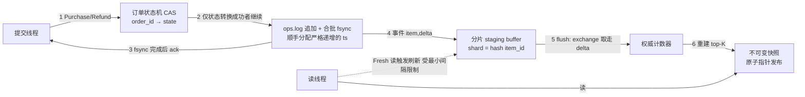

# 实时排行榜（购买/退单）业务需求文档

> 阶段 0 产出。基线方案来自 `rank_proj.md`，本文档只做技术化与补全，不替换架构。
> 文中出现的数值都是默认值，全部可配；性能不预设目标值，以压测实测为准。

---

## 1. 范围

| 项 | 内容 |
|---|---|
| 做 | 单进程多线程的进程内排行榜引擎：操作提交、幂等去重、操作数据落文件、合并刷新、top-K 查询、崩溃恢复、并发压测入口 |
| 不做 | 网络层/RPC、多进程、分布式一致性、真实数据库、用户鉴权、商品与库存管理、金额与支付 |
| 形态 | 静态库 + GoogleTest 用例 + 一个压测/CLI driver |
| 平台 | C++20，MSVC / MinGW 均可构建，不使用平台相关 API |
| 默认规模 | 物品 1e5、订单 1e6、提交线程 1~64、`K_max` 1000。都是压测的默认配置值，可调（FR-18、FR-20） |

---

## 2. 术语表

| 术语 | 定义 |
|---|---|
| Item | 可被购买的物品，主键 `item_id`（uint64） |
| Order | 一次购买事务，主键 `order_id`（uint64），携带 `uid / item_id / qty` |
| Op（操作） | 业务侧动作，仅两种：`Purchase(order_id, uid, item_id, qty)`、`Refund(order_id)` |
| Event（事件） | 排行榜侧动作，`(item_id, delta ∈ ℤ)`。Purchase → `+qty`，Refund → `-qty` |
| StagingBuffer | 待刷新的合并缓冲，`map<item_id, int64 delta>`，按 item 分片。模拟应用进程本地内存 |
| Flush（刷新） | 把 staging buffer 应用到权威计数器，并重建可读快照 |
| Snapshot（快照） | 一次 flush 产出的不可变只读视图，读请求只看快照 |
| 操作文件（`ops.log`） | 顺序追加的操作流水，每条记录是一次操作的**增量**。操作数据的唯一事实来源，不能丢 |
| 排行榜文件（`rank.dat`） | 存**全量** `(item_id, count)` 加一个 `ts_merged`。可以丢，丢了从 `ops.log` 全量重算 |
| `ts`（操作时间戳） | 每条操作一个 uint64 时间戳，由写 `ops.log` 的那个线程分配，**严格递增**，与记录在文件里的先后顺序一致。它同时顶替了「序号」，不另存序号字段（见 FR-14） |
| `ts_merged`（上次合并到哪） | 写在 `rank.dat` 里面：所有 `ts ≤ ts_merged` 的操作，其 delta 已经算进该文件的计数 |
| OrderStore | 订单表 + `ops.log`。模拟数据库：权威数据，不可丢 |
| RankStore | 计数器 + 前 K 名快照 + `rank.dat`。模拟缓存：可以丢，能从 OrderStore 重算 |
| Durable Ack | 提交接口返回成功 ⟹ 该操作已 fsync 到 `ops.log` |
| Staleness（陈旧度） | 当前可读快照与真值之间的时间滞后 |
| Coalescing Ratio（合并比） | `应用到计数器的事件数 / 提交的操作数`，越小越好 |
| T_max / T_min | 定时刷新的周期 / 两次由 `Fresh` 读触发的刷新之间的最小间隔 |

---

## 3. 基线方案的技术化重述

| `rank_proj.md` 原文 | 技术化表述 |
|---|---|
| 「对某个 a 维护一个变量 x」 | 每个 `item_id` 一个 `int64_t` 计数器；该值是**算出来的**，可由 `ops.log` 完整重建 |
| 「购买 = +1，回退 = -1」 | 把业务操作映射成一次整数加法。事件里带的是 `delta`（一个整数），不是操作类型 |
| 「满足交换律，所以可无序」 | 计数器的**最终值**与事件应用顺序无关，不需要全局序号、不需要版本向量。但「中间能看到什么」和「排名」不享有这个性质：读只能看不可变快照（INV-8），排序必须有确定的 tiebreak（FR-7、INV-7） |
| 「维护一个 id 保证幂等」 | 幂等键取业务主键 `(order_id, op_type)`，不引入独立随机 op_id。随机 op_id 只挡得住同一个请求重投，挡不住「同一笔订单被退两次、两次带不同 op_id」；而且它需要一张随时间膨胀的去重表（大小 = 去重窗口 × 写 QPS）。取业务主键之后，订单表本身就是去重表，大小只和订单数有关（§4.1） |
| 「1k 次 +1 压缩成一次 +1k」 | 延迟合并写入。staging buffer 占的内存是 `O(活跃物品数)` 而不是 `O(操作数)` —— 操作提交得再多，它也不会变大 |
| 「必要时按 uid 分片」 | 分片键必须取 `hash(item_id)`，不能取 uid。按 uid 分片会把同一物品的 delta 打散到所有分片：① 合并收益按分片数衰减，合并比变大（1000 次 +1 变成 16 条 +62，而不是 1 条 +1000）；② 每个分片都要写同一个 `count(a)`，权威计数器重新变成竞争点；③ 同一订单的 +qty 和 -qty 可能落在不同分片，先刷到 -qty 就会发布出负计数 |
| 「操作本身要持久化，只在操作排行榜时合并」 | `ops.log` 是唯一事实来源，排行榜是从它算出来的视图；合并只发生在「更新排行榜」这条路径上，不碰持久化路径。这条是本方案最正确的决定 |
| 「延迟更新 + 钦定时间节点」 | 读到的值允许比真值旧，但最多旧 `T_max` |
| 「读请求过来时强制进行一次写」 | 读触发刷新。两点要注意：仅「触发」不够，读者必须等这次刷新真的做完才读得到新值（FR-8 的 `Fresh`）；两次刷新之间要留最小间隔 `T_min`，否则读 QPS 一高，刷新次数就 ≈ 读次数，合并比涨到 1，方案的收益归零 |

数据流（权威路径与可见性路径分离）：

这几步的先后顺序不能改：

- **CAS 在写文件之前**，否则并发的重复操作会同时写两条记录
- **ack 在 fsync 之后**，否则「已经 ack 了却丢数据」就成了合法行为
- **事件投递在 fsync 之后**，否则会出现「排行榜算了、文件里没有」，重启后排行榜永久多于订单表

### 3.1 模块划分：对应真实部署的三层

真实环境里这套业务会这么部署；demo 不引入外部组件，用内存结构和文件模拟同样的分层，模块边界与组件边界一一对应。

| 真实组件 | demo 模块 | 用什么模拟 | 丢了会怎样 |
|---|---|---|---|
| 数据库（订单表） | `OrderStore` | 按 `hash(order_id)` 分片的 hash map + `ops.log` | **丢数据**，不可接受。CAS 代替行锁，`order_id` 是主键 |
| 缓存（排行榜） | `RankStore` | 计数器 map + 前 K 名快照 + `rank.dat` | 不丢数据，扫一遍 `ops.log` 就能重算出来 |
| 应用进程本地内存 | `StagingBuffer` | 按 item 分片的 delta map | 丢的是「还没刷进 `RankStore` 的增量」，同样重算一遍即可 |

由此定下两条贯穿全文的规则：

1. **`OrderStore` 是唯一权威**。幂等判断、能不能退、计数的真值，全部以它为准。
2. **`RankStore` 随时可重建**。它的全部内容都能由 `OrderStore` 重算出来（INV-1 就是这个等式）。它的落盘文件 `rank.dat` 只是让启动时少算一段，任何时候判断不出它对不对，直接作废、从头全量重算即可（FR-17）。

两个文件怎么存、怎么恢复，见 §4.4。

---

## 4. 功能需求

榜单指标是**净购买量**：`count(a) = Σ { order.qty | order.item_id == a ∧ order.state == PURCHASED }`。退单直接抵扣，不保留历史峰值。

### 4.1 操作提交（`OrderStore`）

| ID | 需求 |
|---|---|
| FR-1 | 提供 `Purchase(order_id, uid, item_id, qty)`，成功后该订单对 `item_id` 的计数贡献为 `+qty` |
| FR-2 | 提供 `Refund(order_id)`，成功后撤销该订单的全部贡献（`-qty`） |
| FR-3 | 两个接口均**幂等**：同一 `order_id` 的同类操作重复提交任意次，对计数的影响等于提交一次 |
| FR-4 | 两个接口返回明确结果码：`OK / ALREADY_PURCHASED / ALREADY_REFUNDED / ORDER_NOT_FOUND / INVALID_ARG`。其中 `ALREADY_*` 视为业务成功；`qty ≤ 0` 或 `item_id == 0`（保留值）返回 `INVALID_ARG`，不写 `ops.log` |
| FR-5 | 返回 `OK` ⟹ 该操作已写进 `ops.log` 并 fsync 完成（durable ack）。未返回或返回失败的操作结果未定义，客户端应以相同 `order_id` 重试，由 FR-3 保证幂等 |
| FR-6 | 支持 `qty ≥ 1` 的批量购买；事件 delta 为 `±qty`，不拆成多个 ±1 |

### 4.2 排行榜查询（`RankStore`）

| ID | 需求 |
|---|---|
| FR-7 | `TopK(k, consistency)` 返回前 k 名 `(item_id, count)` 和快照版本号。排序键 `(count DESC, item_id ASC)`，`count == 0` 不进榜；`k > K_max`（默认 1000）返回 `INVALID_ARG`，上榜物品不足 k 个就返回实际条数 |
| FR-8 | `consistency ∈ {Stale, Fresh}`，默认 `Stale`。`Stale` 直接读当前快照，不触发刷新，滞后真值不超过 `T_max`；`Fresh` 触发一次刷新并等它做完，返回的快照包含本次调用开始之前所有已 ack 的操作 |

读接口只有这一个。不做单物品计数查询、任意物品排名、分页、区间查询。

### 4.3 刷新与合并（`StagingBuffer` → `RankStore`）

| ID | 需求 |
|---|---|
| FR-9 | 三类刷新触发，任一满足即刷新：① 距上次刷新 ≥ `T_max`（默认 200 ms）；② `Fresh` 读到达且距上次刷新 ≥ `T_min`（默认 10 ms），`Stale` 读不触发；③ 待刷新物品数 ≥ `N_pending_max`（默认 10000） |
| FR-10 | 多个读请求同时触发刷新时合并成一次：同一时刻最多只有一次刷新在执行，其余读者等这一次的结果 |
| FR-11 | 刷新的开销不落在提交线程上：提交线程不等刷新结束，扫描计数器、选前 K、发布快照都在刷新线程里做。否则刷新频率由读流量决定，提交延迟会跟着读流量抖 |
| FR-12 | 一次刷新取走的 delta，与随之记下的 `ts_merged`，必须严格对应：取走的恰好是 `ts ≤ ts_merged` 的全部操作，不多也不少 —— `ts_merged` 大了会漏算，小了会多算 |
| FR-13 | 暴露指标供验收（§6.2）使用：合并比、刷新次数、刷新耗时、当前陈旧度，以及 INV-9 对账用的 delta 总和。提交延迟与吞吐由压测入口自己统计 |

### 4.4 持久化与恢复（`ops.log` / `rank.dat`）

两个文件，一份是操作数据、一份是排行榜数据；排行榜数据里带着「上次合并到哪条操作」。启动时排行榜只需要补算这个时间戳之后的操作，之前的早就算进去了。

| ID | 需求 |
|---|---|
| FR-14 | `ops.log` 每条记录定长：`ts / op_type / order_id / uid / item_id / qty`，无文件头，单线程顺序追加。`ts` 由这个线程分配，取「当前系统时钟的纳秒值」与「上一条 ts + 1」里的较大值，因此严格递增、与文件里的先后顺序一致，不另存序号字段 |
| FR-15 | 合批 fsync：多个操作凑一批做一次 fsync，批窗口或批大小任一触发即落盘（默认 2 ms 或 4096 条）。**delta 必须在 fsync 返回之后才投递到 StagingBuffer**。写入快过落盘能力时提交线程阻塞等待（队列上限默认 64K 条）；写盘报错则该操作返回失败、不 ack，引擎转为只读 |
| FR-16 | `rank.dat` 内容为 `[ts_merged \| 条目数 \| (item_id, count) × N]`，存**全量计数**。写入必须整文件替换：写 `rank.dat.tmp` → fsync → `rename` 覆盖。落盘频率与刷新频率解耦（默认 1 s 一次，刷新 200 ms 一次） |
| FR-17 | 恢复：① 读 `rank.dat` 取出计数和 `ts_merged`，文件缺失或条目数与文件长度对不上就计数清空、`ts_merged = 0`；② 从头顺序扫 `ops.log`，每条记录都**无条件重建订单表**，delta **只在 `ts > ts_merged` 时**才加到计数器；③ 重算并发布 top-K 快照。订单表不在 `rank.dat` 里，所以 `ops.log` 必须整个扫完，一条都不能跳 |

### 4.5 可测试性

| ID | 需求 |
|---|---|
| FR-18 | 提供并发压测入口，可配置：线程数、操作总数、读写比、退单比例、物品数、Zipf 热点倾斜度、随机种子 |
| FR-19 | 支持注入式崩溃点（在写 `ops.log` 之前、fsync 之后、flush 中途、写 `rank.dat` 的 `.tmp` 与 `rename` 之间等位置模拟进程终止），用于恢复测试 |
| FR-20 | 所有时间与容量参数（`T_max`、`T_min`、`N_pending_max`、`K_max`、合批窗口与批大小、`rank.dat` 落盘周期、分片数、提交队列上限）可通过配置结构注入，测试可设为 0 或极小值。另外 fsync 与文件写入可整体关闭（§6.2 要对比 fsync 开/关，§5 第 7 条要单独测内存路径） |

---

## 5. 本方案明确不保证什么

1. **不保证**读到的榜单是实时值（默认等级下陈旧度 ≤ `T_max`）。
2. **不保证**跨物品的因果关系。两个物品的计数更新无相对顺序约束。
3. **不保证**未 ack 操作的结果（可能已生效）。客户端必须靠幂等重试收敛。
4. **不保证**单物品的写吞吐可水平扩展：同一物品的 delta 固定落在同一个分片，吞吐上限就是单分片的上限。把一个物品再拆成多个计数格、读的时候加起来，这个优化本 demo 不做。
5. **不保证**退单顺序合法性之外的业务校验（无库存、无金额、无风控）。
6. **不保证**多进程/多机一致性——本工程是单进程。
7. **不保证** `ops.log` 占用的磁盘空间有上限 —— 订单表要靠整个文件重建，所以它不能被截断，会一直增长。压测时按需手动清理，或关掉文件写入单独测内存路径。
8. **不提供**历史快照、时间旅行查询、榜单变化订阅。

---

## 6. 验收标准

### 6.1 正确性不变量（必须全部通过）

| ID | 不变量 | 校验方式 |
|---|---|---|
| INV-1 | 停掉所有读写、staging 刷完之后：`∀a, count(a) == Σ{qty \| order.item==a ∧ order.state==PURCHASED}` | 测试里遍历订单表，把 `PURCHASED` 的订单按 item 把 qty 加起来，和计数器逐物品比 |
| INV-2 | **任意时刻**（含 flush 中途）`count(a) ≥ 0`。计数器用 `int64_t` 而不是无符号：万一这条被破坏，表现是可观测的负数，而不是 `1.8e19` 那种让物品永久霸榜的天文数字 | 读线程持续采样 + flush 后比对 |
| INV-3 | 幂等：同一 `(order_id, op_type)` 提交 M 次，最终计数等于提交 1 次 | 并发重复提交用例 |
| INV-4 | 延迟上限：停止写入后 `T_max` 之内，读到的值等于真值 | 定时采样 |
| INV-5 | Fresh 读：读调用前已 ack 的操作，必定体现在返回快照中 | 写后立即 Fresh 读，逐条比对 |
| INV-6 | 崩溃恢复：所有已 ack 操作在重启后全部体现，且**只体现一次**（`ts ≤ ts_merged` 的不重复加）；未 ack 操作要么全有要么全无 | 注入式 kill + 客户端侧 ack 日志比对；重启后立刻跑 INV-1 对账，多算会直接暴露 |
| INV-7 | 排名确定性：相同计数集合 → 相同排名序列 | 重复构造同一状态，比对输出 |
| INV-8 | 快照原子性：单次 `TopK` 返回的所有条目来自同一 `snapshot_version` | 快照内嵌版本号，读侧断言一致 |
| INV-9 | 零丢失：`exchange` 语义下，提交的 delta 总和 == 应用到计数器的 delta 总和 | 全局计数器对账 |

### 6.2 性能验收

不预设目标值，压测报告给出下列实测数据即可；结果不理想就如实记录并分析瓶颈，不允许换口径凑数。

- 写吞吐 vs 提交线程数（1/2/4/8/16/32），fsync 开 / 关各跑一组 —— 关掉是为了把磁盘开销和并发结构开销分开看
- 提交延迟 P50 / P99 / P99.9 vs 合批落盘的批窗口
- `TopK(100)` 的 `Stale` 读吞吐
- 合并比 vs 热点倾斜度（Zipf α = 0 / 0.5 / 1.0 / 1.5）—— 这是本方案的核心收益指标，必须量化
- `Fresh` 读占比（0% / 1% / 10% / 100%）对合并比与写吞吐的影响
- 恢复时间 vs `ops.log` 长度；另外单列一组 `rank.dat` 存在 / 被删，看「只补算一段」比「全量重算」省了多少

### 6.3 工程验收

- `cmake --build` 在 MSVC 与 MinGW 下均成功，无警告
- 全部 GoogleTest 用例通过；并发用例在 `-DGTEST_REPEAT=50` 下稳定
- `docs/TEST_PLAN.md` 中标记为「可自动化」的用例 100% 有对应实现
- 关键并发/幂等代码处注释说明**为什么**（不变量、竞态窗口、内存序理由）
